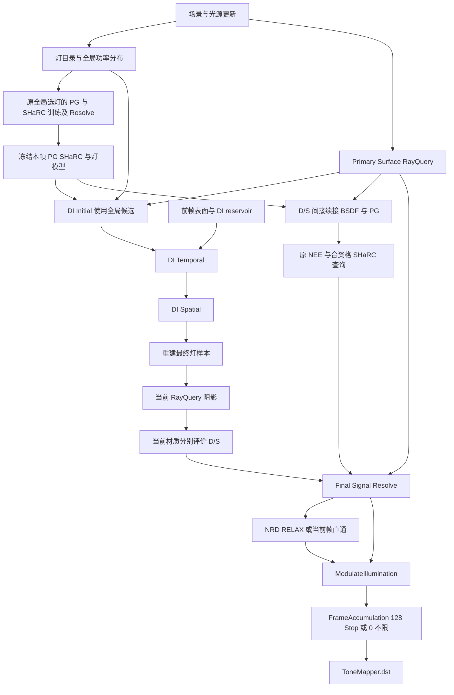
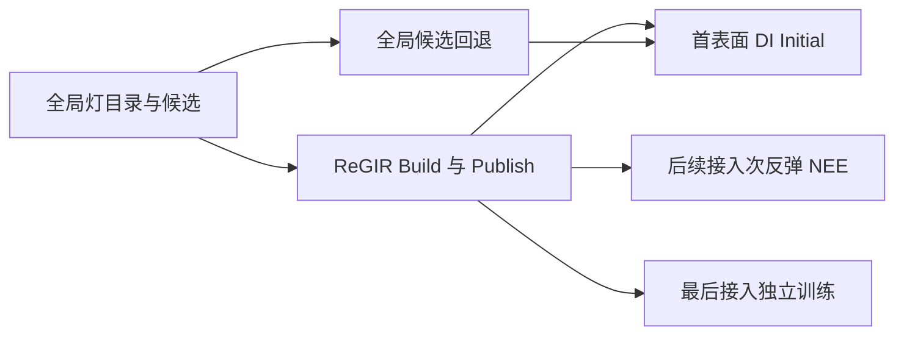

# RTPT 首表面 ReSTIR DI 与 NRD 及后续 ReGIR 接入方案

> RTPT 实验测试代码、场景及验证说明已归档到 `build/rtpt-experiment-tests-backup-20261101/`，并从当前测试构建中移除。下文的阶段验证链接指向历史归档；已有性能报告和图像仍保留在 `build/`。

规划日期：2026-10-31。规划起点：用户确认的 `feabddef`（增加 PG），即 PG、SHaRC、NRD 版本。实施状态更新：2026-11-01；阶段 3 当前采用 S2 着色、T1 发布下一帧历史，实测验收项全部通过：正式均值 162/162、独立 holdout 9/9、四模式物理零 64/64 及运行检查。finalizer 复核实际证据并生成 source/runtime 快照和 manifest。首版 Spatial-feedback 的均值失败保留。

实施顺序按用户要求固定为：先完成首表面 ReSTIR DI 与 NRD 的完整接入和验收，再增加 ReGIR。首批使用全局灯候选，着色沿用本地参考的“最终灯样本 → RayQuery 阴影 → 分别评价 D/S”，与原间接 D/S 合成后送入 NRD。ReGIR 不作为前置条件，也不延后首批 NRD 验收。

全部实现保持现有 ComputePass 与 RayQuery 架构。先保留 D/S 各一条续接的现有积分器，概率式根通道单路径另行评估。本文保留实施设计与参考关系；阶段 1 的结构拆分、阶段 2 的全局 Initial RIS 和阶段 3 的 Temporal/Spatial 均已接入。验证记录见 [阶段 1](../../../build/rtpt-experiment-tests-backup-20261101/tests/rtpt_stage1/README.md)、[阶段 2](../../../build/rtpt-experiment-tests-backup-20261101/tests/rtpt_stage2/README.md) 和 [阶段 3](../../../build/rtpt-experiment-tests-backup-20261101/tests/rtpt_stage3/README.md)。阶段 3 首版把 Spatial 结果反馈到下一帧，mixed_residual 的两个通道超出预注册门槛，源码与运行时已归档。当前工程版本保留当帧 Spatial 着色，改为 Temporal-only 历史；新版本的原 16-seed 六场景正式比较、独立 holdout、GPU/CPU、运行及四模式物理零实测验收已全部通过，finalizer 负责最后 CPU 复核与证据封存。阶段 4 的指定功能/动态组合验收已完成，NRD 画质限制和实测性能范围另见阶段 4 记录。正确性、运动画质和整帧性能分别验收。阶段 5 的 ReGIR Grid 已完成指定组合验收（画质与成本限制见阶段 5 记录），阶段 6 的单路径仍未实施。

## 1 当前实现与模块职责

规划起点没有前一版本的 LocalLights、VXPG、PrimarySurface 或 Generate/Resolve 实现，不能把那些版本的资源和验证结论视为当前基础。现有 `PrimarySurface/`、`Signal/` 和 `ReSTIRDI/` 是本方案阶段 1 至 3 的新实现；下列原积分器职责作为设计基线保留。

- [RTPTLighting.slang](RTPTLighting.slang) 负责环境、发光三角形与解析灯选择。环境图已有重要性采样，发光三角形和解析灯主要均匀选择。当前 `RTPTLightSample` 是即时着色结果，没有持久灯身份和可重建的灯面参数。
- [RTPTSampling.slang](RTPTSampling.slang) 负责 BSDF 与 PG 的方向混合。`rtptContinuationPdf()` 返回实际混合密度，不能在新增灯采样后把它当成纯 BSDF 密度。
- [RTPTNRD.slang](RTPTNRD.slang) 的首表面共用一次选灯与阴影测试，分别评价 diffuse/specular。之后 D/S 各追一条确定性续接，delta 贡献单列 residual。首段真实求交在 RR 之前取得距离。
- [RTPTSharc.slang](RTPTSharc.slang) 在合资格的非根命中查询完整余下辐射，拒绝发光面、delta 和 PG-selected 边；不能按另一版本的配对缓存设计解释当前行为。
- [RTPTSparseUpdate.cs.slang](RTPTSparseUpdate.cs.slang) 保持 BSDF-only 稀疏训练，向 PG 与 SHaRC 提供训练数据。
- [主渲染图](../../../scripts/RTPTSHARCNRD.py) 已包含 RELAX、材质恢复、独立最终累积和 ToneMapper。

新增模块的职责如下。

- ReGIR：根据世界空间位置产生局部灯候选，服务首表面、次反弹及后续可接入的独立训练。
- ReSTIR DI：只重采样首表面的直接光样本。
- PG：选择续接方向，不改作灯目录或 ReGIR 存储。
- SHaRC：提供余下间接辐射，保留资格检查及真实追踪回退。
- NRD：重建当前帧 D/S 信号，不接收 reservoir 权重或旧像素最终颜色作为替代输入。

ReSTIR DI 与间接路径的 ReSTIR GI、ReSTIR PT、GRIS 是不同范围。首版不增加整条间接路径的重采样，也不依赖它们才能完成。

## 2 架构与修改范围

主命中、阴影、续接、训练和重采样所需可见性检查都使用 ComputePass、SceneRayQuery 和 TraceRayInline。Primary Surface 同样由 RayQuery 生成，不照搬 F1 的光栅化主可见性，也不新增 RayGeneration、ClosestHit、Miss 或 DispatchRays 管线。

新增实现放在 RTPT 内；主图、主 CMD、RTPT 专项资源注册和测试按需求维护。共享 Material/BSDF、共享 RTXDI、NRDPass 和 ModulateIllumination 先只读参考。确需修改共享实现时，必须另列具体文件、内容、必要原因及影响并取得用户明确同意。

不恢复旧 NRD continuation A/B split、其专用记录或开关；新信号组装不继承旧记录大小。主命中复用作为固定基础行为，不新增关闭开关；数据不匹配或准备失败时回退真实 RayQuery。多 spp 对照仅允许复用 s=0，独立训练不使用相机主命中。

## 3 推荐实施顺序

首批交付为阶段 1 到 4：全局候选的首表面 ReSTIR DI 与 NRD。通过独立完整管线验收后，才开始阶段 5 的 ReGIR。

### 阶段 1 主表面与最终信号组装

建立 `Primary Surface`，输出当前 HitInfo、重建材质所需引用、位置、法线、粗糙度、深度及运动信息。只保存后续真正需要的数据，不跨 Pass 保存庞大的材质实例或整个路径状态。相机采样、样本索引和抖动必须与原主积分器一致。

建立 `Final Signal Resolve`，统一收集材质化的直接光 D/S、间接光 D/S、emission、residual 和各通道距离，最后去材质化一次并写 NRD 输入。原路径作为新资源准备失败时的完整回退。

验收：新增算法均关闭时，保持原采样规则、随机流、PG/SHaRC 资格与贡献；核对原始 HDR、D/S、距离及 guides。结构重构通过不代表新增重采样通过。

### 阶段 2 全局候选与最终灯样本到 NRD 的闭环

建立 RTPT 私有的 `LightKey`、`LightSampleRef` 和灯目录代次。记录灯类型、稳定身份、灯面随机参数、真实候选来源及其概率。灯集合重排不能让历史索引指向另一盏灯。

从全局均匀或功率分布生成候选，不分配 ReGIR 网格。先实现仅含当前帧候选的 Initial RIS，关闭 Temporal/Spatial。保存 SDK 定义的 reservoir 状态，通过正确的 finalize/get-inverse-PDF 接口取得估计权重，不能把 streaming `weightSum` 直接当作最终密度。

本阶段立即打通最终着色与 NRD：读取最终灯样本，在当前表面执行一次 RayQuery 阴影，使用同一个已正确除权的入射光分别评价当前材质的 D/S，随后与原间接 D/S 合成、统一去材质化并交给现有 RELAX。主要参考本地 `RTXDIPass/FinalShading.cs.slang`，不等待 ReGIR 或时间空间复用完成后才连接 NRD。

ReSTIR DI 各阶段具体调用、数据布局、参考函数和交付检查见[第 11 节](#11-restir-di-具体实现与参考对应)。

第一版可先覆盖发光三角形与明确支持的有限局部解析灯。环境、方向光和不支持的灯型继续走独立的旧路径，并用明确的贡献域标志区分。准备失败与合法的零/不可见样本分开：准备失败可整段回退；抽到零贡献不能再补抽旧 NEE。

验收：单灯、不同功率多灯、部分遮挡、发光纹理和 alpha-tested 灯面的原始 HDR 均值，同时检查 D/S 去材质化与恢复、NRD 开关直通和主图输出。先区分估计偏差与有限样本噪声，不依靠 NRD 或最终累积掩盖错误。

本阶段已实施并完成当前验收：全局均匀 Initial、持久灯引用、当前阴影与真实 D/S、NRD 闭环、预算与开关回退；具体结果及有限预算统计的适用范围见 [阶段 2 验证说明](../../../build/rtpt-experiment-tests-backup-20261101/tests/rtpt_stage2/README.md)。本阶段的验收范围不包含 Temporal、Spatial；其实现与独立验收归阶段 3。

### 阶段 3 首表面 ReSTIR DI 的时间与空间复用

以阶段 2 的全局候选 Initial 和 NRD 闭环为基础，依次增加 Temporal、Spatial，分别实施和验收。此阶段仍不启用 ReGIR。Temporal 需要前一帧表面、相机与灯身份；Spatial 从独立输入 bank 读取，避免同一 dispatch 内原位覆盖邻居。

历史样本在当前接收表面重建并重新评价当前 BSDF、灯光、目标函数与归一化。检查深度、法线、材质、视图边界、灯身份与代次。合法黑色、不可见和无效身份采用各自的事件规则，不能按亮度选择估计器。

最终灯样本共用一次当前阴影 RayQuery，分别评价当前材质的完整 diffuse 与 specular，输出两个分量。一个 DI reservoir 不等于随机给赢家贴 D/S 标签；目标函数应支持两者的非零贡献。

初版每帧重新测试最终可见性。历史可见性复用、confidence 输入、融合 Pass 和梯度反馈留待正确性通过后单独优化。

当前状态（2026-11-01）：独立 Temporal/Spatial ComputePass、四个 reservoir/sidecar bank、前帧 Primary Surface、完整精度灯面 UV 与 SDK RayTraced 校正已经接入。当前帧在组合模式下从 Spatial S2 重建最终灯并着色，下一帧 Temporal 的历史独立从 T1 发布；Spatial 不再递归反馈给未来 Temporal，T-only 保持 T1 发布路径。两份样本的准备、身份和可见性标记独立处理，不能用 S2 的着色结果裁定 T1 历史是否有效。裸 RTPT 的两个复用开关默认关闭以保留阶段 2 行为，正式主图与主 CMD 默认开启；可单独运行 Initial、T-only、S-only 和 T+S。普通相机移动允许重投影，几何、材质、灯内容或身份变化、明显相机切换、frustum、resize 及明确选项/seed 变化保守丢弃历史。复用资源超预算保留 Initial，基础 DI 准备失败再恢复原直接光域。

首版的历史证据为：关闭 T/S 后 precise/default 合计 120/120 数组字节一致；D3D12 debug layer 下 23/23 GPU 测试通过；动态生命周期 213 帧 441/441 检查通过；720p 主图 144 帧 37/37 检查通过；NRD 关闭时通用格式/材质检查 12/12 记录通过（11 项不同检查），另有实际 T/S 激活 2/2 检查。真实动画的主深度由 3.0 变为 2.25，并验证历史清空与恢复。这些记录保留，不作为新版本生产验收；首版完整源码/运行时见 [first-implementation](../../../build/rtpt-stage3/first-implementation/manifest.json)，结果路径与版本界限见 [阶段 3 验证说明](../../../build/rtpt-experiment-tests-backup-20261101/tests/rtpt_stage3/README.md#recorded-results-2026-11-01)。

首版正式均值结果：T-only 与 S-only 对 Initial 的六场景原始 HDR/D/S 比较各 54/54 通道通过。T+S 前四场景 36/36 通过，但 mixed_residual 的 HDR.R、D.R 相对 Initial 分别出现约 +0.669%、+0.679% 均值提升，达到 5.0974、5.1452 paired SE，超出固定 `5 × paired SE + 1e-7` 门槛；失败证据保留，不因更换历史架构撤销。首版四模式各自在 blocked、zero_domain 两场景的 16 项检查全部通过，合计 64/64。统计仍为每个 seed 重建图与场景、32 帧历史预热后采集 128 帧，以 16 个独立 paired run 的整段均值估计标准误差；未增删原 seed、增加预算或改变门槛以改判首版通过。

[CPU 配对审计](../../../build/rtpt-stage3/mixed-residual-pairing-audit.json) 的 58 项一致性检查通过，未找到所检查的配对、配置、恢复或 ROI/通道错误；[窗口诊断](../../../build/rtpt-stage3/mixed-residual-window-diagnostic.json) 保留逐 32 帧均值与跨 seed 标准误差。随后仅改变历史来源的单次固定结构控制，在原 16 seeds 上对 Initial 的 9/9 通道通过，见 [控制比较](../../../build/rtpt-stage3/diagnostic-temporal-history/diagnostic-comparison.json) 和 [原字节恢复](../../../build/rtpt-stage3/diagnostic-temporal-history/restoration.json)。它支持当前工程选择，但不证明根本原因、SDK bug 或统计偶然，也不替代新的正式验收。

当前新 DLL `01621a5b…` 的正式六场景均值已全部通过：[T-only](../../../build/rtpt-stage3/final-temporal-compare.json)、[S-only](../../../build/rtpt-stage3/final-spatial-compare.json)、[T+S](../../../build/rtpt-stage3/final-combined-compare.json) 各 54/54，合计 162/162。每场景使用全部原 16 seeds、32 帧历史预热及 128 帧测量，门槛仍为 `5 × paired SE + 1e-7`。[独立 holdout](../../../build/rtpt-stage3/final-holdout-compare.json) 在预先锁定的 16 个新种子上通过 mixed_residual 的 9/9 通道；注册见 [preregistration](../../../build/rtpt-stage3/final-holdout-preregistration.json)。新版本还完成 24/24 GPU、8/8 CPU、关闭复用 120/120 字节一致、生命周期 441/441（213 帧、40 snapshots）、720p 主图 37/37（144 帧）、NRD bypass 12+2 检查，具体报告见 [当前结果](../../../build/rtpt-experiment-tests-backup-20261101/tests/rtpt_stage3/README.md#current-temporal-history-implementation)。Initial/T-only/S-only 与首版 3744/3744 NPY 字节一致另作为版本间行为不变性证据，不替代同版本均值验收。

新的四模式物理零已完成：[Initial](../../../build/rtpt-stage3/final-zero-initial/report.json)、[T-only](../../../build/rtpt-stage3/final-zero-temporal/report.json)、[S-only](../../../build/rtpt-stage3/final-zero-spatial/report.json)、[T+S](../../../build/rtpt-stage3/final-zero-combined/report.json) 在 blocked、zero_domain 两场景各通过 16 项检查，合计 64/64；[队列状态](../../../build/rtpt-stage3/final-acceptance-status.json) 为 done/passed。阶段 3 实测验收完成，最终 `final-manifest.json` 和 source/runtime 快照由 finalizer 复核生成。历史恢复的 61 runs 只属于首版 DLL，未用于新生产验收。旧均值失败、控制与 185 文件归档继续保留；这些结果不证明根本原因、SDK bug 已修复、普遍无偏性或阶段 4 画质/整帧性能已通过。

### 阶段 4 首表面 ReSTIR DI 与 NRD 完整组合验收

保持原 D/S 双续接及 delta residual，将 ReSTIR DI 作为新的首表面直接光来源，在 Final Signal Resolve 中与间接信号求和，然后接回现有 RELAX 和材质恢复。

先验证原始 D/S 重建，再验证 NRD 静止、平移、快速转向、显露、灯变化和 resize。使用主入口单独执行 PG、SHaRC、首表面 ReSTIR DI、NRD、累积与后处理全开，以及各模块关闭后恢复的验收。此批次不包含尚未实施的 ReGIR，不能以等待 ReGIR 为由推迟验收；通过后首批方案独立成立。

2026-11-01 实施记录：阶段 4 已完成本批工程接入和指定场景的功能/动态组合验收。保持原 D/S 双续接、delta residual、距离及材质恢复契约；仅修正普通平移触发 PG 重训时不应连带清空 RELAX 历史的问题，显式重置、结构重建、内容、视锥和 resize 仍保留历史失效处理。新 DLL `fb4b76f7…` 的 GPU 24/24、CPU 8/8、原始信号 100/100、动态及同图六模块关闭恢复 986/986、复杂场景 368/368、实际主 CMD 720p 独立进程组合 13/13 全部通过；95 份 shader 与阶段 3 封存版本字节一致。具体证据、运行时边界、初次测试场景错误的保留记录及复现方式见[阶段 4 验证说明](../../../build/rtpt-experiment-tests-backup-20261101/tests/rtpt_stage4/README.md)。

画质范围明确保留：静止窗口时域方差降至原始的约 1.36%，但既有 NRD 输入限幅与滤波/历史伴随平均能量下降，细镜面细节变软，未滤波 delta residual 仍有亮点。有限原始均值不是收敛真值，未宣称能量完全一致、普遍无偏、细节完全保留或所有场景性能达标。首批无需 ReGIR 即可独立运行；后续 ReGIR 仍须单独实施与验收。

### 阶段 5 后续接入 ReGIR

2026-11-01 实施结果：RTPT 私有 RTXDI 1.3 Grid 建表、首表面 DI Initial、次反弹和 BSDF-only 独立训练已接入；Grid 在本帧训练前构建，PG 模型仍在主渲染后发布。保留全局、准备/预算失败、网格外回退及合法零贡献不补抽；极端目标比例增加同候选集均匀保护。D/S 双续接、delta residual、物理距离、Signal Resolve、共享 RELAX 与材质恢复契约保留。31 项 GPU、4 项 CPU、234 项正式均值标准、2 个物理零场景、115 项原始重建、1,353 项动态及 453 项复杂场景检查通过；真实主 CMD 的 ReGIR 开/关/恢复三组 64 帧与原六模块关闭/恢复十二组 8 帧均通过。ReGIR 关闭后 45 份原始输出与阶段 4 逐字节一致。指定场景运动功能签收保留 NRD 细节软化、输入限幅、未滤波残差亮点；少灯测试 7/10 像素方差增加，720p 入口开启 ReGIR 增加约 1.0–1.2 ms，未证明普遍画质或速度收益。完整来源、限制与封存见 [阶段 5 验证说明](../../../build/rtpt-experiment-tests-backup-20261101/tests/rtpt_stage5/README.md)。本批仅 Grid，不含 Onion、F1 cascade 或阶段 6 概率根通道。

阶段 4 通过后，才从已验证的全局候选路径扩展到世界空间选灯：从全局均匀或功率分布生成候选，按体素内任意接收表面的重要性代理进行 RIS，再发布本帧只读网格。网格外、预算不足或准备失败时保留全局灯池路径。

ReGIR 首版优先使用已安装 RTXDI SDK 的 Grid/Onion 结构，以减少新数学与资源布局同时变化。F1 的近远两层 cascade 是另一种后续空间布局，不是启用 ReGIR 的必要条件。每格样本数和总容量按预算调节，不把 F1 的 512 条记录当作最小要求。

先把 ReGIR 候选接入已完成的首表面 DI Initial，保持最终灯样本、RayQuery 阴影、D/S 评价和 NRD 信号契约；再独立接次反弹，最后接 PG/SHaRC 的 BSDF-only 训练。每一处接入都验证其权重和缓存目标。训练读取世界空间候选，不读取主像素 DI reservoir，也不重复消费邻居或历史的着色反馈。

首版不按亮度距离硬剔除灯。保留全灯候选来源与正支持；功率估计为零但实际仍可能发光的纹理不能被永久排除。Emitter 分层、连通岛拆分和二维空间预筛选属于后续规模优化，需独立说明支持域或近似误差。

完成后再执行包含 ReGIR 的主入口完整组合验收，并与阶段 4 的无 ReGIR 结果分别比较原始信号、NRD 画质、显存和整帧成本。

ReGIR 已有实现的代码入口、建格与查询细节及本地 1.3 适配问题见[第 12 节](#12-regir-实现参考与适配方案)。

### 阶段 6 概率式根通道单路径

在前述管线稳定后，才评估 F1 式根 D/S 随机选择。需要根通道概率补偿、未选通道的距离重建、稀疏信号和运动画质专项。

当前 NRD 3.1 README 的 Interaction with Path Tracers 明确指出：1 rpp 概率式根 D/S 分离会使距离难以用于跟踪，距离除以 PDF 和未选通道写零都会产生问题。本地版本没有新 SDK 的 `HitDistanceReconstructionMode`。因此首版不把单路径作为完成条件；若选择升级 NRD 或增加重建适配，须另行规划共享框架范围，不能直接拷贝新 sample 接口。

## 4 首批管线与后续 ReGIR 扩展

### 4.1 首批 ReSTIR DI 与 NRD 管线

以下是阶段 1 到 4 的交付管线，不依赖 ReGIR。最终灯样本、阴影和 D/S 着色分别列出，明确着色发生在 NRD 输入生成之前。



阶段 4 验收包含该管线全部已有模块和新 ReSTIR DI，不包含 ReGIR。融合、异步和资源复用应在分阶段正确性通过后测量决定。

### 4.2 后续 ReGIR 的帧内位置

阶段 5 在全局候选与 DI Initial 之间增加以下候选来源，并分步扩展次反弹和训练。最终灯样本到 NRD 的后半段继续复用阶段 4 的已验证管线。



开发上先完成 ReSTIR DI 与 NRD，再增加 ReGIR；ReGIR 实施后，每帧仍须先构建并发布网格，供本帧 DI Initial 等查询使用。训练尚未接入时继续使用原全局选灯。

## 5 ReSTIR 与 NRD 的具体信号契约

### 5.1 在当前表面评价最终灯

Final DI Shading 读取最终 reservoir、当前 Primary Surface 和当前灯目录，重建灯样本并测试阴影。输出保持材质化的 `directDiffuse`、`directSpecular`，同时记录灯距离和有效性；不在这里提前做 NRD 打包。

若调用 Falcor `getFinalSample()` 风格接口，其 `Li` 已包含灯面采样及 reservoir 的除权，调用方只乘当前 BSDF 与可见性。若直接使用 SDK 的原始 `radiance`，则按该版本接口显式应用固体角密度和 reservoir 归一化。两种表示不能混用，否则会重复除 PDF。

当前材质的两个 active-lobe 视图分别调用公共 `mi.eval()`。不复制旧像素的已去材质 RGB，不把 ReGIR 体素的代理材质当成最终材质，也不为此修改共享 BSDF。

### 5.2 首表面贡献域与 MIS

查到本地 PathTracer 参考后，首版优先采用其已有的完整直接光贡献域分离：ReSTIR DI 独占它所覆盖的首表面非 delta 直接光，原首表面 NEE 不再计算同一域；首段续接直接命中被覆盖光源的 emission 也不重复加入。

贡献域所有权由本像素、本帧采样前已成功准备的 DI 模式和 coverage mask 决定。最终 reservoir 没有赢家、灯被遮挡或贡献为黑色，都不恢复这一域的原 NEE 或续接 emission；只有采样前确定的准备失败，才一致切回原完整路径。

只跳过被 DI 覆盖的那一个直接光事件，不能终止整条间接路径，不能跳过该表面后续反射。主表面自身 emission、delta 路径、未覆盖环境光、未支持灯型和更深反弹保留各自明确规则。DI 只覆盖局部灯时，不得照搬参考代码中无条件跳过首段环境 miss 的逻辑；剩余类别及类别内未覆盖光源子集的真实 PMF/PDF 都需与实际抽样和命中 MIS 一致。例如有限局部灯与 Directional 同属 analytic，不能只改类别概率却仍使用原全类别灯数除权。

上一轮讨论的另一种方案是固定参考密度互补分配：以参考灯密度 `r` 和实际 PG/BSDF 续接密度 `q_D/q_S` 构造 `hL + hB = 1`，RIS/ReSTIR 估计 `f * hL`，续接估计 `f * hB`。它是积分分配方案，`r` 不是 ReSTIR 的实际边际 PDF。该方案可保留为后续独立实验，不能与完整 DI 独占模式叠加使用，也不能把 reservoir 有效权重倒数直接送进旧 power heuristic。

次反弹接入 ReGIR 时，单独确定 NEE 与 BSDF/PG 发光命中的互补方案；可沿用上述参考密度分配，但必须验证真实 RIS 归一化、同一测度和支持域。SHaRC/PG 训练仍为 BSDF-only 方向，不因共享候选灯而隐式改为 PG 运输。

当前 SHaRC 会拒绝发光面，因此真实命中路径上的发光事件仍可被辨认，再按上述覆盖域选择保留或排除。不能把整个非发光终点的 `cachedRadiance` 再乘首表面 emitter MIS，否则会压暗更长的间接路径。

### 5.3 先合成再去材质化

初版保持以下关系，其中 `R_D/R_S` 是当前主表面的恢复因子：

```text
L_D = directDiffuse  + indirectDiffuse
L_S = directSpecular + indirectSpecular

NRD_D.rgb = L_D / R_D
NRD_S.rgb = L_S / R_S

HDR = emission + filteredD * R_D + filteredS * R_S + residual
```

当前 `max(kNRDMinReflectance, factor)` 与 GGX specular factor 可继续作为起点。分母和材质恢复必须使用同一约定；不要直接复制旧 RTXDI sample 的 Lambert/F0 简化模型，也不要把它已经去材质的 diffuse 再除一次 albedo。

纯 delta 和当前超出 NRD 范围的 residual 继续独立。NRD 关闭时沿用当前帧 D/S 直通和相同材质恢复。NRD 输入格式启用与 NRD 实际 Enabled 保持分离。

### 5.4 距离按信号类型处理

纯 DI 示例可以把灯距离写入 D/S 的 `.w`。这不等于在混合 PT 信号中用灯距离覆盖间接首段距离。

第一版保留现有 D/S 真正续接射线取得的首段距离，即从主表面到下一次真实命中的距离；不包含相机主射线段、不除以 PDF、不乘 reservoir 权重，也不把多跳长度直接相加。SHaRC 在下一命中终止时仍保留真实第一段距离。

新增显式有效性，区分没有该 lobe、没有成功生成续接、真实 miss 和合法零辐射。初版保持当前距离契约；真实 miss 仍采用已有有限 miss 约定，不能因为 DI 非零就改成灯距离，也不能把无 lobe 或续接采样失败一律解释为新版 NRD 的零距离缺失输入。

纯直接光配置的灯距离，以及混合信号的代表距离或能量选择，属于后续独立画质实验，不是重采样权重恒等式。先与当前距离基线比较，不能直接照抄 sample 的启发式当作已证明的通用规则。

当前有限 miss 距离和 NRD 深度范围按本地版本处理；无限灯距离不能把 Infinity 写入 FP16 资源。

### 5.5 guides 和两套历史

NRD 的法线、粗糙度、viewZ、motion 和恢复因子都来自当前 Primary Surface。ReSTIR 自身保留前帧表面及 reservoir；这两套历史不能互相代替。

普通 ReGIR 重建、候选刷新及不改变信号定义的 PG 发布，不应每帧触发全部历史清空。相机切换、resize、灯身份失效、格式和模式切换按规则重置。当前 PG 在实际相机平移时重训，其对 NRD reset 的传播也要专项核对，避免新增 Temporal 后仍在普通运动中每帧丢弃历史。

最终累积达到 128 Stop 后，上游 ReGIR、ReSTIR、训练和 NRD 继续运行。模块切换须重置受影响的 NRD 与最终累积，不能用已停止的画面判断开关失效。

### 5.6 HDR 范围和原始参考

当前共享 NRD PackRadiance 已有 luminance clamp，主图 `maxIntensity=250`，且会原位修改输入。原始 HDR 验证应在该步骤前读取或保存独立参考；filtered 输出及关闭 NRD 的 blit 经过 FP16，格式误差与估计偏差分开报告。

若高亮持续被截断，可在 RTPT 适配层增加固定线性尺度 `s`：输入为 `s * L / R`，材质恢复输出因子为 `R / s`，emission/residual 不跟随缩放。NRD 关闭直通也使用同一逆变换。首版用固定场景尺度，避免动态曝光增加历史问题；缩放不是对原始能量的任意 clamp。

### 5.7 首版组装伪代码

以下为职责伪代码，函数名不代表仓库已经存在的接口。`coverage` 在准备阶段确定，不能依据本像素最终样本是否明亮或可见来改变。

```text
primary = loadCurrentPrimarySurface(pixel)
coverage = diResourcesPrepared ? configuredLightDomain : emptyDomain

direct = shadeFinalDIReservoirAtCurrentSurface(pixel, primary)
    # 在当前像素重建灯，执行一次阴影，返回已正确除权的 D/S

indirect = traceExistingDiffuseAndSpecular(primary, coverage)
    # 保留两条真实续接与其首段距离
    # 仅排除已由 DI 独占的根直接光事件，保留更深反弹与 SHaRC

diffuse  = direct.diffuse  + indirect.diffuse  + uncoveredDirect.diffuse
specular = direct.specular + indirect.specular + uncoveredDirect.specular

writeLinearNRDInputs(diffuse / factorD, specular / factorS,
                    selectedHitDistances, currentGuides)
writeEmissionResidualAndFactors(emission, residual, factorD, factorS)
    # 后续共享 NRDPass 执行一次 SDK pack 与 RELAX
```

`uncoveredDirect` 是未覆盖光源域的原 NEE，其选灯类别和互补命中密度需保持一致。DI 完整覆盖所有已支持域时该项为零；DI 整体不可用时必须先决定整段回退，再执行原直接光与原互补规则。Final Signal Resolve 不再追踪射线或重复提交训练反馈。

## 6 资源和代码落点

建议按职责新增 RTPT 私有目录，名称是规划，尚非现有实现。阶段 1 到 4 仅需主表面、全局灯候选、ReSTIR DI 和 NRD 组装，ReGIR 资源与调度留到阶段 5：

- `PrimarySurface/`：RayQuery 主命中、当前与前帧表面、材质重建与 guides。
- `DirectLighting/`：LightKey、灯目录、RTXDI 私有 bridge、全局候选和 ReGIR。
- `ReSTIRDI/`：Initial、Temporal、Spatial、Final DI Shading 及历史资源。
- `RTPTNRD.slang` 与新 Final Signal Resolve：当前 D/S 组装、距离与去材质化。
- `RTPT.cpp/.h`：资源预算、ComputePass 调度、实际 active 状态、回退原因和历史失效。
- `scripts/RTPTSHARCNRD.py`、`RTPR_START.cmd` 与 RTPT 专用 CMake：主图连线、启动开关及文件注册。

原积分器保留作对照和资源准备失败回退。资源预算分别统计 ReGIR、DI reservoir、当前/历史表面与中间信号；不把记录预算当整帧显存，也不预先承诺增加 Pass 会提速。

## 7 模块开关和回退

新增可选功能必须同时提供主 CMD 1/0 开关和运行时 Enabled。首批提供 `restirDIEnabled`、`restirDITemporalEnabled`、`restirDISpatialEnabled`；`regirEnabled` 及其资源调度在阶段 5 一起接入，不把空开关当作 ReGIR 已实现。概率式根单路径以后另设独立模式与开关，不复用旧 continuation split 名称。

- ReGIR 关闭时，DI Initial 仍可用全局候选；预算失败采用同一回退。
- ReSTIR DI 关闭时，ReGIR 仍可服务合法的普通 NEE。
- Temporal 或 Spatial 关闭时，使用前一合法阶段结果，保留参数。
- PG、SHaRC、NRD、最终累积和 ToneMapper 保留各自控制及原回退。
- `enableNRD=True` 保持 D/S 资源连线；`NRD.enabled=False` 控制实际降噪直通。
- requested、active、fallbackReason 必须区分，不能仅凭请求开关认为新路径已执行。

## 8 分阶段验收

1. 结构等价：新增算法关闭后的原始信号、guides、距离、随机流和原路径恢复。
2. 全局候选与 Initial RIS：单灯、多灯、极端功率、局部遮挡、发光纹理、灯身份及支持域；原始 HDR 均值和显存预算。立即核对最终灯样本、RayQuery 阴影、D/S 评价到 NRD 的闭环。
3. DI Initial、Temporal、Spatial 分别验收；检查同灯重复合并、归一化、运动、显露、快速转向、灯移动/增删和 resize。
4. 核对覆盖光源域：原 NEE、BSDF/PG 直接发光命中、环境和 delta 不重复、不漏算。
5. 原始 D/S 乘回材质后重建 HDR，再检查 NRD 亮度、纹理、高光与运动响应。
6. 首批使用主入口执行 PG、SHaRC、ReSTIR DI、NRD、累积和后处理全开，以及各模块关闭后恢复；运行超过 128 Stop，另测 0 不限。此时尚无 ReGIR，验收独立完成。
7. 首批通过后，单独实施和验收 ReGIR 建表、查询、支持域、预算、网格外回退和权重，再分别扩展次反弹及训练。
8. 执行包含 ReGIR 的第二批主入口完整组合，逐项回归首批场景和开关；保留无 ReGIR 对照。
9. 两批性能比较均包含准备、训练、重采样、最终信号组装和 NRD 的整帧 GPU 时间与显存；同时间画质和相同画质成本分别报告。

VeachAjar 保留为完整管线回归场景；另需多灯分布和动态遮挡场景。少灯场景可能只增加预处理成本，不能用 F1 的多灯阶段加速数字承诺 RTPT 提速。

## 9 本地参考代码

### 9.1 Falcor 当前版本的最终 DI 着色

[RTXDIPass/FinalShading.cs.slang](../RTXDIPass/FinalShading.cs.slang) 的 `FinalShading.execute()` 是最接近 RTPT 的起点：读取最终灯样本，通过 SceneRayQuery 做阴影，使用同一灯分别评价 D/S，再去材质化；入口本身为 compute。其灯距离输出适用于该直接光 Pass，不能直接覆盖 RTPT 混合间接信号的首段距离。

[Rendering/RTXDI/RTXDI.slang](../../Falcor/Rendering/RTXDI/RTXDI.slang) 的 `getFinalSample()` 展示最终灯的重建和归一化，`generateCandidates()` 展示 Initial；现有包装层传给 SDK 的 ReGIR 候选数为 0，因此不能只打开一个属性就宣称已有 ReGIR 集成完成。

[Rendering/RTXDI/RTXDIApplicationBridge.slangh](../../Falcor/Rendering/RTXDI/RTXDIApplicationBridge.slangh) 展示 Slang 与 SDK 的表面、灯、随机数及可见性适配。当前代理材质是简化模型；RTPT 最终着色必须使用当前真实材质。共享代码先只读，新增 bridge 放在 RTPT 内。

### 9.2 当前 PathTracer 的贡献域分离

[PathTracer.slang](../PathTracer/PathTracer.slang) 的 `handleHit()` 在首表面使用 RTXDI 最终样本代替 NEE，对 RTXDI 分支不再套普通灯/BSDF MIS；第二顶点的非 delta 发光贡献按覆盖规则跳过。`handleMiss()` 对环境也有相应规则。

这些事件规则可在 RTPT 内重写，不能直接采用该 PathTracer 的 RT Pipeline 调度，也不能在 DI 未覆盖环境时复制其全域环境排除。

[PathTracer/NRDHelpers.slang](../PathTracer/NRDHelpers.slang) 的 `setNRDPrimaryHitReflectance()`、`setNRDSampleHitDist()` 分别展示恢复因子和首个续接命中距离。delta/transmission 的复杂处理不自动纳入当前 RTPT 首版。

### 9.3 已安装的 RTXDI 1.3 示例

`dependencies.xml` 固定 `rtxdi=1.3.0-falcor`、`nrd=3.1.0-falcor-windows-x86_64`。本地安装包已经带 ReGIR、Initial、重采样和 NRD 示例：

- [RTXDI.h](../../../external/packman/rtxdi/rtxdi-sdk/include/rtxdi/RTXDI.h)：ReGIR Grid/Onion、容量和上下文参数。
- [PresampleReGIR.hlsl](../../../external/packman/rtxdi/shaders/LightingPasses/PresampleReGIR.hlsl)：体素灯样本预选。
- [GenerateInitialSamples.hlsl](../../../external/packman/rtxdi/shaders/LightingPasses/GenerateInitialSamples.hlsl)：从全局/ReGIR 生成当前帧样本。
- [ShadeSamples.hlsl](../../../external/packman/rtxdi/shaders/LightingPasses/ShadeSamples.hlsl)：读取最终 reservoir，并调用着色及信号输出。
- [ShadingHelpers.hlsli](../../../external/packman/rtxdi/shaders/LightingPasses/ShadingHelpers.hlsli)：`ShadeSurfaceWithLightSample()`、`StoreShadingOutput()`；展示共享 D/S 灯、最终可见性、直接与后续信号合并、仅最后阶段调用 NRD pack。
- [LightingPasses.cpp](../../../external/packman/rtxdi/src/LightingPasses.cpp)：ReGIR 与重采样调度，需采用 RayQuery 分支。
- [NRD 3.1 README](../../../external/packman/nrd/README.md)：本地版本距离、去材质化及概率根通道限制。

优先评估针对已安装 SDK 写 RTPT 私有适配，避免为接入首版同时升级共享 SDK。旧版示例的材质近似、checkerboard、距离启发式和显式 NRD pack 都不能不加区分地照搬。RTPT 保持原始线性 D/S 输出，由现有 NRDPass 执行一次 SDK pack。

## 10 外部参考与版本核对

- [F1 25 GDC 分享](https://gdcvault.com/play/1035693/EA-Sports-F1-25-Path)：工程结构和数据整理经验，不能替代未公开的重采样实现。
- [RTXDI Integration](https://github.com/NVIDIA-RTX/RTXDI/blob/main/Doc/Integration.md)：ReGIR、Initial、Temporal、Spatial、最终着色与世界空间使用方式。
- [RTXDI Application Bridge](https://github.com/NVIDIA-RTX/RTXDI/blob/main/Doc/RtxdiApplicationBridge.md)：可重建样本引用、灯身份映射和可见性接口。

### 10.1 RTXDI FullSample

以下源码固定到 RTXDI 提交 `a6efab966b7c3b272da0461578eb56ac61c7cbff`，该版本为 RTXDI 3.1.0。它的 NRD 子模块固定到 `2cd553031abec76bc4e109f20ef40a23ef0645c7`，实际为 [NRD 4.17.1](https://github.com/NVIDIA-RTX/NRD/blob/2cd553031abec76bc4e109f20ef40a23ef0645c7/Include/NRD.h)。不能把本表中的新版 API 签名直接用于本地 RTXDI 1.3 与 NRD 3.1。

1. [PresampleReGIR.hlsl](https://github.com/NVIDIA-RTX/RTXDI/blob/a6efab966b7c3b272da0461578eb56ac61c7cbff/Samples/FullSample/Shaders/LightingPasses/Presampling/PresampleReGIR.hlsl#L19) 与 [LightingPasses.cpp](https://github.com/NVIDIA-RTX/RTXDI/blob/a6efab966b7c3b272da0461578eb56ac61c7cbff/Samples/FullSample/Source/RenderPasses/LightingPasses/LightingPasses.cpp#L645)：局部灯预采样、环境预采样、ReGIR 构建及发布顺序。
2. [ReSTIRDIRenderPasses.cpp](https://github.com/NVIDIA-RTX/RTXDI/blob/a6efab966b7c3b272da0461578eb56ac61c7cbff/Samples/FullSample/Source/RenderPasses/LightingPasses/ReSTIRDIRenderPasses.cpp#L81)：Initial、Temporal、Spatial、Shade 的调度和阶段间 UAV barrier。
3. [GenerateInitialSamples.hlsl](https://github.com/NVIDIA-RTX/RTXDI/blob/a6efab966b7c3b272da0461578eb56ac61c7cbff/Samples/FullSample/Shaders/LightingPasses/DI/GenerateInitialSamples.hlsl#L34)、[TemporalResampling.hlsl](https://github.com/NVIDIA-RTX/RTXDI/blob/a6efab966b7c3b272da0461578eb56ac61c7cbff/Samples/FullSample/Shaders/LightingPasses/DI/TemporalResampling.hlsl#L59)、[SpatialResampling.hlsl](https://github.com/NVIDIA-RTX/RTXDI/blob/a6efab966b7c3b272da0461578eb56ac61c7cbff/Samples/FullSample/Shaders/LightingPasses/DI/SpatialResampling.hlsl#L38)：逐阶段的实际输入、buffer bank、运动向量转换和重采样调用。
4. [ShadeSamples.hlsl](https://github.com/NVIDIA-RTX/RTXDI/blob/a6efab966b7c3b272da0461578eb56ac61c7cbff/Samples/FullSample/Shaders/LightingPasses/DI/ShadeSamples.hlsl#L47) 和 [ShadingHelpers.hlsli](https://github.com/NVIDIA-RTX/RTXDI/blob/a6efab966b7c3b272da0461578eb56ac61c7cbff/Samples/FullSample/Shaders/LightingPasses/ShadingHelpers.hlsli#L54)：一个最终灯样本、一次最终可见性、同一个 reservoir 归一化，分别评价 D/S。这是 ReSTIR 到 NRD 前端最直接的代码参考。
5. [SceneRenderer.cpp](https://github.com/NVIDIA-RTX/RTXDI/blob/a6efab966b7c3b272da0461578eb56ac61c7cbff/Samples/FullSample/Source/App/SceneRenderer.cpp#L1135)：启用间接光时令 DI 的 `enableDenoiserInputPacking=false`，随后依次执行 DI、间接光、Denoiser、Compositing。[StoreShadingOutput](https://github.com/NVIDIA-RTX/RTXDI/blob/a6efab966b7c3b272da0461578eb56ac61c7cbff/Samples/FullSample/Shaders/LightingPasses/ShadingHelpers.hlsli#L125) 先合并既有 D/S，最后阶段才做 NRD pack。RTPT 借鉴其时序，但把 pack 留给当前 NRDPass，避免重复打包。
6. [NrdIntegration.cpp](https://github.com/NVIDIA-RTX/RTXDI/blob/a6efab966b7c3b272da0461578eb56ac61c7cbff/Samples/FullSample/Source/RenderPasses/DenoisingPasses/NrdIntegration.cpp#L479) 和 [CompositingPass.hlsl](https://github.com/NVIDIA-RTX/RTXDI/blob/a6efab966b7c3b272da0461578eb56ac61c7cbff/Samples/FullSample/Shaders/CompositingPass.hlsl#L74)：NRD 资源绑定、D/S 恢复材质和 emission 合成。其 Lambert/F0 近似与本地 GGX 恢复因子不同，不能混用。

RayQuery 必须由 RTPT 自己保证。[官方 host 创建 ShadeSamples 的位置](https://github.com/NVIDIA-RTX/RTXDI/blob/a6efab966b7c3b272da0461578eb56ac61c7cbff/Samples/FullSample/Source/RenderPasses/LightingPasses/ReSTIRDIRenderPasses.cpp#L37) 在该提交将此 Pass 的 RayQuery 参数写成 `false`；虽然 shader 和 [RAB_VisibilityTest.hlsli](https://github.com/NVIDIA-RTX/RTXDI/blob/a6efab966b7c3b272da0461578eb56ac61c7cbff/Samples/FullSample/Shaders/LightingPasses/RtxdiApplicationBridge/RAB_VisibilityTest.hlsli#L82) 提供 inline 分支，仍不能原样照搬该 host 调度。

### 10.2 NRD Sample

`NRD-Sample` 用于学习路径分类、距离及去材质化，不是现成 ReSTIR 实现。[固定 main 的 README](https://github.com/NVIDIA-RTX/NRD-Sample/blob/200d70ab9b73744254eb000f729ff61b91c5cd72/README.md#L19) 明确其重要性采样不是 ReSTIR。其太阳直接光还另走 SIGMA，再在合成中加回；这与把 ReSTIR DI 的 D/S 合入同一 RELAX 信号的目标不同。

- [main TraceOpaque.cs.hlsl](https://github.com/NVIDIA-RTX/NRD-Sample/blob/200d70ab9b73744254eb000f729ff61b91c5cd72/Shaders/TraceOpaque.cs.hlsl#L156) 的 FULL 模式：确定性 D/S 双路径，比概率模式更接近当前 RTPT 首版。[辐射与距离归一化代码](https://github.com/NVIDIA-RTX/NRD-Sample/blob/200d70ab9b73744254eb000f729ff61b91c5cd72/Shaders/TraceOpaque.cs.hlsl#L454) 明确两者采用不同统计，不能给 hitT 应用辐射的概率补偿。
- [simplex TraceOpaque.cs.hlsl](https://github.com/NVIDIA-RTX/NRD-Sample/blob/4e4e3ac6fd87851fddbff8e686b6041372c51468/Shaders/TraceOpaque.cs.hlsl#L170)：概率根通道选择及 throughput 的 `1/p` 补偿；根选择使用 Bayer/Weyl 序列辅助邻域覆盖。[路径末端](https://github.com/NVIDIA-RTX/NRD-Sample/blob/4e4e3ac6fd87851fddbff8e686b6041372c51468/Shaders/TraceOpaque.cs.hlsl#L333) 按根标签路由整条辐射并去材质化。
- [RaytracingShared.hlsli](https://github.com/NVIDIA-RTX/NRD-Sample/blob/4e4e3ac6fd87851fddbff8e686b6041372c51468/Shaders/RaytracingShared.hlsli#L975) 和 [Composition.cs.hlsl](https://github.com/NVIDIA-RTX/NRD-Sample/blob/4e4e3ac6fd87851fddbff8e686b6041372c51468/Shaders/Composition.cs.hlsl#L140)：使用同一套新版材质因子进行去材质化与恢复。
- [NRDSample.cpp](https://github.com/NVIDIA-RTX/NRD-Sample/blob/4e4e3ac6fd87851fddbff8e686b6041372c51468/Source/NRDSample.cpp#L497)：显式开启 `AREA_3X3` 缺失距离重建。该 simplex 提交的 NRD 固定为 [4.18.0](https://github.com/NVIDIA-RTX/NRD/blob/8f12a22fc90e6a3c7f5da4c9c3103633c842963a/Include/NRD.h)，不是当前 3.1 所具备的接口。

Sample 的 PSR、前帧 L1 cache、曲率修正、太阳 SIGMA 和玻璃处理不是本轮先决条件。先保留 RTPT 已支持的反射路径和 SHaRC，不把 sample 的所有附加功能一并引入。

### 10.3 优先阅读顺序

先读本地 `RTXDIPass/FinalShading.cs.slang` 与 `RTXDI.getFinalSample()`，按“最终灯样本 → RayQuery 阴影 → 分别评价 D/S”建立首批着色；再读 Initial、Temporal、Spatial 和 DI/间接光/NRD 时序，结合 RTPT 当前距离与恢复因子完成阶段 1 到 4。首批验收通过后，才读 ReGIR 的上下文、Presample 与查询代码并实施阶段 5。NRD-Sample simplex 的概率根路径与 4.x 重建设置仅用于阶段 6。

## 11 ReSTIR DI 具体实现与参考对应

### 11.1 实现路线和首版范围

首版采用仓库已安装的 RTXDI 1.3 重采样算法，在 RTPT 内编写私有 application bridge、资源和 ComputePass 调度。SDK 负责 reservoir 的流入、合并、归一化和偏差校正；RTPT 负责场景、材质、灯、历史表面、运动及 RayQuery。F1 分享用于理解工程结构，本地 SDK 与实际 shader 用于确定算法调用，不能只根据分享描述自行补完重采样权重。

当前 SDK 的核心位于 [ResamplingFunctions.hlsli](../../../external/packman/rtxdi/rtxdi-sdk/include/rtxdi/ResamplingFunctions.hlsli) 与 [Reservoir.hlsli](../../../external/packman/rtxdi/rtxdi-sdk/include/rtxdi/Reservoir.hlsli)。本地版本的函数是 `RTXDI_SampleLightsForSurface`、`RTXDI_TemporalResampling`、`RTXDI_SpatialResampling`；新版参考的 `RTXDI_DITemporalResampling` 等名称不能直接替换进 1.3。

先关闭 ReGIR、checkerboard、可见性历史复用、boiling filter 和 fused resampling，采用全分辨率、独立 Initial/Temporal/Spatial/Final Shade。各阶段复用当前 D/S 双续接与现有 RELAX。初始化时令 ReGIR 候选数为 0；首版也可令 BRDF 候选数为 0，先验证纯灯候选 RIS，再单独增加其他候选技术及其概率。

覆盖域先包含实际支持的发光三角形与有限局部灯。环境和未覆盖灯型按第 5.2 节保留独立原路径。带发光纹理、alpha test、单面发光或光照 profile 的灯，必须保留当前真实求值；对不支持的类型明确回退，不能只保留灯目录编号却丢失其材质行为。

### 11.2 RTPT 私有 bridge 需要提供什么

以 [Falcor RTXDIApplicationBridge.slangh](../../Falcor/Rendering/RTXDI/RTXDIApplicationBridge.slangh) 为接口参考，在 RTPT 内适配以下职责，不修改共享 bridge。

1. 表面：`RAB_GetGBufferSurface`、有效性、位置、法线、深度、视线方向和材质相似性。读取当前或前帧 Primary Surface，不使用 NRD 过滤后的图像重建几何。
2. 灯：`RAB_LoadLightInfo`、样本随机参数到当前灯面点的重建、光源类别与实际提议概率。`RAB_TranslateLightIndex` 必须处理身份映射或明确使历史失效，不能照搬共享 bridge 中直接返回原索引的假设。
3. 目标函数：`RAB_GetLightSampleTargetPdfForSurface` 在接收表面评价 D/S 的非负标量重要性，首版优先使用当前完整材质评价，避免只按 diffuse 选择却遗漏镜面支持。目标函数只用于选样，最终 RGB 仍在当前表面重新计算。
4. 可见性：`RAB_GetConservativeVisibility`、`RAB_GetTemporalConservativeVisibility` 等接口使用 SceneRayQuery。初始样本筛选、偏差校正和最终阴影分别遵循同一套已选择的 SDK 策略，不能随意混合不同的支持规则。
5. 随机数：为 Initial、Temporal、Spatial 分配可复现的独立随机流，与原 BSDF/PG 续接流分开。关闭 DI 时不额外推进原积分器随机流。

前帧表面必须保留跨帧目标函数评价所需的数据。不能用当前已移动的几何、已修改的材质和旧 HitInfo，假装还原上一帧状态。首批先验证静态几何和相机运动；不能可靠恢复来源状态的变化采用明确历史失效，后续再扩大动态支持。

### 11.3 数据与 reservoir bank

主表面保存命中与重建引用、位置/深度、几何和着色法线、粗糙度、当前视线及目标函数所需材质数据，并保留对应历史。持久灯样本保存 `LightKey + sampleUV + generation`，不保存上一像素已经着色的 RGB 作为样本身份。

Reservoir 采用 SDK 的 `RTXDI_Reservoir/RTXDI_PackedReservoir` 语义：样本引用、目标值、权重、M，以及按需要使用的可见性/年龄。代次和额外有效性由 RTPT 适配层管理；不要未经确认把代次塞入 SDK 已占用的索引位。

本地 packed 定义为 24 B，但实际资源 stride 仍以参数反射与布局检查为准；不能混用 3.x 的记录格式。Streaming 的 `weightSum` 是权重和，Finalize 后则表示最终 inverse-PDF 权重，字段名相同不代表两个阶段数值含义相同。

资源先按以下四个逻辑 bank 组织：

- `R_initial` / I0：本帧新鲜候选。
- `R_temporal` / T1：本帧新鲜候选与前帧历史合并；Temporal 开启时也是下一帧历史的来源。
- `R_spatial` / S2：空间阶段输出，随后用于当前帧最终着色，不递归反馈给未来 Temporal。
- `R_history` / H3：前一帧发布的历史样本，在本帧 Temporal 读取结束前保持只读。

同时保留当前/前帧表面。阶段之间设置 UAV barrier，Spatial 不能原位边读邻居边写同一 bank。当前组合模式分别选择 `finalInputBank=2` 和 `historyInputBank=1`：S2 决定本帧着色，T1 的完整 SDK reservoir 和 UV sidecar 独立发布到 H3。发布发生在历史读取完成后；历史准备失败、无效身份和合法零按其自身记录处理，不能借用 S2 的 RGB 或可见性判定。这里描述逻辑职责，物理分配优化后置，显存按实际容量统计。

Temporal 关闭时，Spatial 从 `R_initial` 读取，不消费跨帧 Temporal 历史；Spatial 关闭时，Final Shade 使用 Temporal 或 Initial 的实际有效输出，T-only 继续发布 T1。开关改变按规则清空历史，不能在重新开启 Temporal 时消费先前 S-only 的记录。天空、越界和无效表面必须写出明确空 reservoir，不能留下上一帧同像素的内容。

### 11.4 Initial 如何产生第一份样本

直接参考本地 [GenerateInitialSamples.hlsl](../../../external/packman/rtxdi/shaders/LightingPasses/GenerateInitialSamples.hlsl) 和 [RTXDI.slang](../../Falcor/Rendering/RTXDI/RTXDI.slang) 的 `generateCandidates()`（235 行）。

每像素读取当前表面，从全局均匀或功率分布抽取若干灯及灯面随机参数。实际来源概率包含类别、类别内选灯和灯面采样；解析 delta 灯与连续面灯使用 SDK 规定的各自测度，不能人为把 delta 的方向 PDF 当作普通非零固体角 PDF。

对于单一提议分布的独立 Initial RIS，可用下式理解权重。`F_D/F_S` 是在统一样本测度下、尚未除以提议概率的两路物理贡献，`t` 是非负目标函数，`p` 是真实提议概率：

```text
t(y) = nonnegativeImportance(F_D(y) + F_S(y))
w_i  = t(y_i) / p(y_i)
以 w_i / sum(w) 的概率留下一个候选 y*
W    = sum(w) / (candidateCount * t(y*))
Initial 直接光估计 = W * (F_D(y*), F_S(y*)) * currentVisibility
```

目标函数必须对最终非零贡献保持支持；若目标省略阴影，最终可见性在 Final Shade 计算。合法零候选仍按算法的试验计数规则处理，不只统计明亮候选。多种提议混合和后续历史合并使用 SDK 规定的权重，不能把上面单层公式直接扩展成通用 Temporal/Spatial 公式。

实际代码调用 `RTXDI_InitSampleParameters(...)` 和 `RTXDI_SampleLightsForSurface(...)`，然后存入 `R_initial`。高层函数已经完成它要求的归一化；本地 1.3 在初始阶段末还会把对外 reservoir 的 M 设为 1。不能再手工 Finalize、重复除候选数，或把 M 改回初始抽灯次数。可见性预筛选是否执行，需与后续偏差校正模式一起固定并验证。

先将 `R_initial` 直接交给 Final Shade，立即验证最终灯样本到 NRD 的闭环；不等待 Temporal/Spatial 或 ReGIR。

### 11.5 Temporal 如何复用历史

直接参考本地 [TemporalResampling.hlsl](../../../external/packman/rtxdi/shaders/LightingPasses/TemporalResampling.hlsl)、`RTXDI.slang` 的 `doTemporalResampling()`（367 行），以及 SDK `RTXDI_TemporalResampling()`。

1. 读取当前表面和 `R_initial`，根据当前表面的前帧位置，投影到前帧相机，查找历史表面与 reservoir。
2. 核对视图边界、深度、法线、材质、灯映射和代次，限制历史长度；不满足条件时保留本帧新鲜候选。
3. 在当前接收表面重新评价历史样本的目标函数，按 SDK 模式进行合并和校正，写 `R_temporal`。
4. 历史样本失效不能阻止本帧新鲜候选覆盖显露区域；无效身份与合法零贡献分别处理。

RTPT 当前 `mvecW` 是世界空间位置差，不是 SDK 要求的像素空间 motion。应结合当前/前帧相机矩阵、几何前帧位置和一致的抖动约定转换，motion 的 z 分量与 bridge 采用的深度定义一致。不能复制共享 wrapper 中 `motion.xy * frameDim` 并忽略 linear z 的 TODO。先用静态场景的相机旋转、平移和显露验证方向及单位，再扩展动态物体。

本地 SDK 要求 `motion.xy = previousPixelPosition - currentPixelPosition`，单位是像素；`motion.z = previousLinearDepth - currentLinearDepth`。重投影使用 `pixel + motion.xy` 与 `currentDepth + motion.z`。二者必须与实际表面快照、相机和抖动约定一致，不能只按名字猜测 motion 正负号。

本地 bridge 只保存当前灯信息、历史索引原样返回的做法，也不是完整动态灯实现。有可靠对应关系才复用，否则使受影响历史失效。只有当前 TLAS 时，历史可见性与偏差校正的限制必须单独验证，不能据静态结果宣称所有动态条件严格无偏。

### 11.6 Spatial 如何使用邻居

直接参考本地 [SpatialResampling.hlsl](../../../external/packman/rtxdi/shaders/LightingPasses/SpatialResampling.hlsl)、`RTXDI.slang` 的 `doSpatialResampling()`（327 行），以及 SDK `RTXDI_SpatialResampling()`。

读取当前中心样本，并从只读输入 bank 取得邻居样本。先检查几何与材质相似性，再在中心和 SDK 校正所需的来源表面上重新评价目标。由 SDK 完成 reservoir 合并、样本计数和偏差校正，写另一输出 bank；不能直接复制邻居的已着色 RGB，或把所有邻居当作一个普通新鲜候选而丢掉原 M/权重。

首版先用独立 Spatial Pass，邻域数量和半径作为可调参数。偏差校正模式及其可见性检查按所选 SDK 实现执行；关闭校正的快速模式如果另行引入，必须明确是独立的质量/偏差选择，不能与验收基线混为一谈。

本地模式区分 Off、Basic、Pairwise 和 RayTraced。Off 的简单归一化属于有偏快速模式；Basic/Pairwise 的可见性假设与 RayTraced 不同。静态场景先以带可见性校正的 RayTraced 路径作为参考，再单独评价更快模式；该模式名不自动证明 RTPT 在缺少前帧灯或加速结构的所有动态条件下严格无偏。来源交叉评价中的可见性、Initial 赢家筛选及最终阴影是三项不同职责。若按 SDK 规则丢弃遮挡赢家，保留其规定的 M，不能把这次试验当作没有发生过；首版关闭 visibility shortcut。

### 11.7 Final Shade 如何连接现有 NRD

直接参考本地 [FinalShading.cs.slang](../RTXDIPass/FinalShading.cs.slang) 的 `FinalShading.execute()`（81 行起）与 `RTXDI.getFinalSample()`（473 行起）。执行顺序固定为：

```text
最终 reservoir
→ 用当前灯目录与 sampleUV 重建最终灯样本
→ 当前 SceneRayQuery 阴影
→ 同一个已正确除权的入射光，分别调用当前 diffuse/specular BSDF eval
→ directDiffuse / directSpecular
→ 与原 D/S 间接信号及未覆盖直接光合并
→ 一次去材质化与现有 NRDPass
```

`getFinalSample()` 风格返回的是已加权入射光，不能再次除源 PDF 或再乘一次 reservoir 权重。Final Shade 也不再套原普通 NEE 的根 MIS；首段发光/环境事件按第 5.2 节的覆盖域规则处理。单个最终灯对 D/S 共用一次最终阴影测试；Initial 筛选和重采样偏差校正仍可能需要额外射线，所以不能据此宣称整套 DI 每像素只有一条阴影射线。

输出端继续使用 [RTPTNRD.slang](RTPTNRD.slang) 当前的恢复因子、D/S 双续接首段距离、emission/residual 和 guides；SDK 打包只在现有 NRDPass 执行一次。具体数值、距离与历史要求见第 5 节。

### 11.8 文件和实施任务对应

下列是 RTPT 内拟新增的职责文件，名称可在实现时统一，但不改共享实现：

- `ReSTIRDI/RTPTReSTIRDI.h/.cpp`：预算、buffer bank、SDK 参数、生命周期与 ComputePass 调度。参考 [RTXDI.cpp](../../Falcor/Rendering/RTXDI/RTXDI.cpp) 的 `beginFrame/update/endFrame` 和外部 FullSample 的独立 DI Pass 调度；不照抄其 RT Pipeline 分支。
- `ReSTIRDI/RTPTDIBridge.slangh`：实现当前/历史表面、灯引用、目标函数、motion、随机数与 SceneRayQuery 的 SDK bridge。
- `ReSTIRDI/RTPTDIInitial.cs.slang`：全局候选 Initial；ReGIR 候选数固定为 0，直到阶段 5。
- `ReSTIRDI/RTPTDITemporal.cs.slang` 与 `RTPTDISpatial.cs.slang`：对应阶段的实际 SDK 调用、只读输入与输出 bank。
- `ReSTIRDI/RTPTDIShade.cs.slang`：最终灯样本、RayQuery、当前 D/S 评价，输出未打包的直接光。
- Primary Surface 和 Final Signal Resolve：分别产生唯一当前表面及统一 NRD 信号，按照第 3 节先完成结构等价与闭环。

先检查已安装 SDK 的 Slang include、参数反射、buffer 布局和宿主符号是否能在 RTPT 目标内使用，再增加算法阶段。需要新增注册和 include 路径时仅修改 RTPT 专用目标。编译通过只说明集成可运行，不能代替权重与画质验收。

### 11.9 ReSTIR DI 每步完成条件

Initial 完成条件是正确全局提议与目标、合法 reservoir 权重、最终 D/S 着色和 NRD 闭环；Temporal 完成条件增加运动、显露、身份变化和历史重建；Spatial 完成条件增加邻域支持、跨材质边界和校正模式。每步都保留原始 HDR 均值对照，最后执行阶段 4 的主入口全功能验证。

专项检查至少包含：合法空 reservoir 不补抽、遮挡不触发估计器切换、同一光源在历史/邻居重复出现时权重正确、灯目录重排不串灯、高光与漫反射共用 reservoir 不漏支持、原直接光不重复、DI 开关恢复、预算回退和 128 Stop 后上游继续运行。通过这些检查后再开始 ReGIR，不把后续选灯优化当作修复前面权重错误的方法。

## 12 ReGIR 实现参考与适配方案

### 12.1 优先采用哪一份参考

ReGIR 有完整公开实现，当前安装的 RTXDI 1.3 包中也已包含建格、Grid/Onion 坐标映射、着色点查询和示例调度。RTPT 首版优先以这些版本匹配的代码为算法参考，在 RTPT 私有适配层集成；新版 NVIDIA RTXDI-Library 用于对照结构，论文用于核对采样原理，第三方离线实现用于补充学习。

这一节只细化阶段 5，不改变“先首表面 ReSTIR DI 与 NRD，验收后再 ReGIR”的顺序。ReGIR 首先只改变已经完成的 DI Initial 的候选来源；最终灯样本、RayQuery 阴影、当前 D/S 评价及 NRD 后半段继续使用前一阶段契约。

### 12.2 本地完整实现入口

以下行号对应当前安装的 `1.3.0-falcor`，不是外部 3.x 版本：

1. [RTXDI.h](../../../external/packman/rtxdi/rtxdi-sdk/include/rtxdi/RTXDI.h) 的 `ReGIRMode` 与 `ReGIRContextParameters`（46、53 行起）：定义 Disabled、Grid、Onion、每格槽位数及网格/分层尺寸。`FrameParameters` 提供中心、格宽和查询抖动参数。
2. [SDK RTXDI.cpp](../../../external/packman/rtxdi/rtxdi-sdk/src/RTXDI.cpp) 的 `InitializeOnion()`（56 行）、`GetRisBufferElementCount()`（209 行）、`GetReGIRLightSlotCount()`（219 行）和 `FillRuntimeParameters()`（257 行）：分层布局、槽位总数、RIS 区段偏移及帧参数。
3. [RtxdiHelpers.hlsli](../../../external/packman/rtxdi/rtxdi-sdk/include/rtxdi/RtxdiHelpers.hlsli) 的 `RTXDI_ReGIR_WorldPosToCellIndex()`、`RTXDI_ReGIR_CellIndexToWorldPos()`：Grid 分支从 38、53 行起，Onion 分支从 91、140 行起。这里同时定义查询抖动的空间尺度。
4. [PresampleReGIR.hlsl](../../../external/packman/rtxdi/shaders/LightingPasses/PresampleReGIR.hlsl)（17 行起）：纯 compute 的入口，一个线程处理一个格内灯槽。
5. [ResamplingFunctions.hlsli](../../../external/packman/rtxdi/rtxdi-sdk/include/rtxdi/ResamplingFunctions.hlsli) 的 `RTXDI_PresampleLocalLightsForReGIR()`（671 行）：网格建表的实际 RIS 算法；`RTXDI_SampleLocalLightsFromReGIR()`（777 行）：选择体素候选或全局回退；`RTXDI_SampleLightsForSurface()`（926 行）：把结果接入表面 Initial。
6. [示例 RtxdiApplicationBridge.hlsli](../../../external/packman/rtxdi/shaders/LightingPasses/RtxdiApplicationBridge.hlsli) 的 `RAB_GetLightTargetPdfForVolume()`（601 行）和 [PolymorphicLight.hlsli](../../../external/packman/rtxdi/shaders/PolymorphicLight.hlsli) 的 `getWeightForVolume()`：不同灯型的体素重要性估计；其中三角形版本位于 679 行起。
7. [示例 LightingPasses.cpp](../../../external/packman/rtxdi/src/LightingPasses.cpp)（435 至 469 行附近）：先执行需要的局部灯预采样，再 dispatch ReGIR，之后才消费灯样本。这里只借鉴职责顺序，实际调度仍使用 RTPT 的 ComputePass。

### 12.3 网格里实际保存什么

本地实现的 ReGIR 灯槽存于 RIS buffer，每槽是 `uint2`：灯索引及其 RIS 归一化权重的位表示；可另有 compact light 数据缓存。它不是每像素的 24 B DI reservoir，也不是把固定灯面 UV、D/S RGB 和完整路径都存入体素。

每格有多个这样的槽。构建时，各槽通过若干全局候选选出代表灯；查询具体着色点时，再针对该灯产生灯面参数并进行表面 RIS。每格槽数 `LightsPerCell`、每槽建表候选数 `numRegirBuildSamples`、每次表面查询的候选数，是三个不同参数，不能统称为每格采样数。

SDK 默认 Grid 为 16×16×16、每格 512 槽；仅 8 B 槽数组即为 16 MiB，不包含 compact light、全局/环境 RIS、DI 历史和表面。该默认值不是 RTPT 的性能结论。预算和建表成本按真实槽数、每槽候选数及其他资源一起统计，再决定实际配置。

### 12.4 构建步骤

`RTXDI_PresampleLocalLightsForReGIR()` 的实际流程为：

1. 根据全局槽编号求 `cellIndex` 和格内槽序号。
2. 通过 Grid/Onion 映射取得格子中心与支持半径；结合查询 jitter 扩大评价范围。
3. 从全局均匀灯池，或已经生成的功率预采样 RIS 区段中取得候选灯及来源权重。
4. 由 `RAB_GetLightTargetPdfForVolume(light, center, radius)` 估计该灯对整个查询体积的重要性。
5. 进行加权 reservoir 选择并归一化，把选中灯索引及权重写入槽。
6. 建表结束设置 barrier，再向 DI Initial 或其他世界空间使用者发布本帧只读模型。

体素目标函数不等于某个像素的完整 BSDF，也不等于已计算的阴影。局部均匀网格的首个版本可以按帧重建，以明确数据有效性；相机滚动复用、按需更新和跨帧持久化后置，不因“world space”就假设旧槽自然对应新的网格位置。

先使用 SDK Grid 验证映射和权重，再按实测需要评估 Onion 的距离分层。它们是 ReGIR 灯候选结构，不替换 PG 的区域、方向树或 SHaRC 的辐射哈希表。F1 的两层 cascade 不是 SDK Onion 的同义词，另做布局时需重新验证支持范围与 jitter。

运行参数优先由同版本 `FillRuntimeParameters()` 生成。尤其本地 Onion 会在宿主侧转换 cell size 和 jitter 的尺度，不能只复制 shader 字段名并直接填入 UI 原值，否则构建支持半径与查询尺度可能不一致。

### 12.5 着色点如何查询

`RTXDI_SampleLocalLightsFromReGIR()` 首先对真实表面位置施加规定的空间抖动，再计算 cell index。在有效网格内，从该格的灯槽中取候选；网格关闭或位置不在网格时，回到全局灯池/全局预采样区。

随后内部函数在真实接收表面重新生成灯面样本，评价当前目标函数并进行第二层 RIS，得到可供 DI Initial 合并的结果。ReSTIR 的 Temporal/Spatial 继续作用在每像素 reservoir 上，而不是直接在这个体素槽数组上执行。

最终可见性仍由后续 RayQuery 处理。只从 ReGIR 取出灯索引、用均匀选灯概率除权，或者把格内归一化权重当作表面真实边际 PDF，都会破坏估计。体素目标、表面目标及各自的来源权重必须遵循同一版本 SDK 的分层归一化。

网格外回退与合法空槽不同：本地查询在 `cellIndex < 0` 时选择全局来源；有效 cell 的合法零权重槽不会自动变成全局补抽。RTPT 不按查询亮度临时切换估计器。若增加全局防御候选或混合来源，必须预先定义选择概率和合并规则，并验证支持域。

体素代理零值只应排除已证明对其整个支持域贡献为零的情况。不能把近似功率、发光纹理估计或距离启发式产生的零值当作无条件支持裁剪；新增硬裁剪应明确误差或提供合法的全局候选方案。

### 12.6 当前 Falcor 包装层不是已完成的 ReGIR

虽然 SDK 有完整实现，共享 Falcor RTXDI 包装层有两个明确空缺：[RTXDI.slang](../../Falcor/Rendering/RTXDI/RTXDI.slang) 的 `generateCandidates()` 在 248 行将 ReGIR 候选数设为 0；[RTXDIApplicationBridge.slangh](../../Falcor/Rendering/RTXDI/RTXDIApplicationBridge.slangh) 的体积目标函数在 329 行起直接返回 0。

因此不能只添加一个 UI 开关便宣称 ReGIR 已启用。RTPT 私有适配需要提供实际体素目标函数、上下文与资源、建表 dispatch、barrier、查询参数和预算回退。共享包装层与已安装 SDK 保持只读；新增功能在 RTPT 内适配。

本地 1.3 查询还存在必须按实际源码适配的参数行为：`RTXDI_SampleLocalLightsFromReGIR()` 计算了一个局部 `numSamples`，但调用 `RTXDI_SampleLocalLightsInternal()` 时没有传入它；内层实际按 `sampleParams.numLocalLightSamples` 循环。因此不能假定 `numRegirSamples` 字段独立控制该版本的实际查询条数。

初版可以在 RTPT 侧将启用时的 `numRegirSamples` 与 `numLocalLightSamples` 绑定为同一个正数，并核对初始化参数和实际抽样计数；关闭时令 ReGIR 数为 0、保留全局候选数。若以后需要分开调节，必须在私有适配中一起处理实参与归一化，不能只改循环次数或擅改共享 SDK。

RTPT 的 build 入口还应在调用 SDK 前检查 `lightSlot < actualSlotCount`。本地示例使用向上取整 dispatch，而底层无效 cell 分支仍按传入槽地址写零，额外线程可能越过 ReGIR 区段；不存在局部灯时也不调 build，避免灯数减一的下溢。所有 RIS 区段用上下文返回的容量和偏移配置，防止覆盖环境或全局预采样数据。

### 12.7 NVIDIA 官方新版和原始论文

- [RTXDI-Library 的 ReGIR 目录](https://github.com/NVIDIA-RTX/RTXDI-Library/tree/main/Include/Rtxdi/ReGIR)：独立的 `ReGIR.h`、`ReGIRParameters.h` 和 [ReGIRSampling.hlsli](https://github.com/NVIDIA-RTX/RTXDI-Library/blob/main/Include/Rtxdi/ReGIR/ReGIRSampling.hlsli)。用于对照新版结构，不能与本地 1.3 的参数布局或函数签名混用。
- [RTXDI FullSample 的 PresampleReGIR.hlsl](https://github.com/NVIDIA-RTX/RTXDI/blob/a6efab966b7c3b272da0461578eb56ac61c7cbff/Samples/FullSample/Shaders/LightingPasses/Presampling/PresampleReGIR.hlsl#L19) 及 [LightingPasses.cpp](https://github.com/NVIDIA-RTX/RTXDI/blob/a6efab966b7c3b272da0461578eb56ac61c7cbff/Samples/FullSample/Source/RenderPasses/LightingPasses/LightingPasses.cpp#L645)：主机调度与 compute 建表示例。具体版本与跨版本限制见第 10.1 节。
- [Rendering Many Lights with Grid-Based Reservoirs](https://research.nvidia.com/labs/rtr/publication/boksansky2021rendering/)：Boksansky、Jukarainen、Wyman，Ray Tracing Gems II 第 23 章。解释原始世界空间 Grid/RIS 思路；[作者提供的正文](https://cwyman.org/papers/rtg2-manyLightReGIR.pdf) 包含算法与伪代码。论文原始 Grid、SDK Onion 与 F1 cascade 分别核对，不混称为同一空间布局。

### 12.8 补充实现 HIPRT Path Tracer

[Tom Clabault 的 ReGIR 文章](https://tomclabault.github.io/blog/2025/regir/) 配有公开实现，以下源码固定在 `9e996753986706ea41b558ccb891242bb43ae2c3`：

- [GridFill.h](https://github.com/TomClabault/HIPRT-Path-Tracer/blob/9e996753986706ea41b558ccb891242bb43ae2c3/src/Device/kernels/ReSTIR/ReGIR/GridFill.h#L304)：`ReGIR_Grid_Fill()`、格内候选生成、归一化及写入。
- [TriangleEmissiveSamplingReGIR.h](https://github.com/TomClabault/HIPRT-Path-Tracer/blob/9e996753986706ea41b558ccb891242bb43ae2c3/src/Device/includes/LightSampling/TriangleEmissiveSamplingReGIR.h#L12)：接收表面查询、邻格和 canonical 候选组合。
- [FinalShading.h](https://github.com/TomClabault/HIPRT-Path-Tracer/blob/9e996753986706ea41b558ccb891242bb43ae2c3/src/Device/includes/ReSTIR/ReGIR/FinalShading.h#L15)：`sample_one_light_ReGIR()` 及最终可见性。
- [ReGIRRenderPass.cpp](https://github.com/TomClabault/HIPRT-Path-Tracer/blob/9e996753986706ea41b558ccb891242bb43ae2c3/src/Renderer/RenderPasses/ReGIRRenderPass.cpp#L519)：建格与复用的主机调度。

它基于 HIPRT/Orochi、HIP/CUDA C++，偏向离线收敛并提供交互预览，含代表表面、稀疏格、额外归一化及复用扩展。适合阅读支持域和候选组织，不作为 RTPT 的 HLSL/Slang、D3D12、RayQuery 首版直接移植来源。其当前 README 还注明 ReSTIR DI 已删除，因此不是现成的 ReGIR、ReSTIR DI、NRD 全管线示例。

### 12.9 RTPT 后续接入的最小步骤

1. 阶段 4 的 ReSTIR DI 与 NRD 验收通过后，先完成 ReGIR 上下文、Grid 映射、预算和 RTPT 私有体素目标。
2. 单独检查每个槽的建表来源、权重、无灯/无效 cell、dispatch 尾线程、区段边界及实际候选计数。
3. 将 ReGIR 只接到首表面 DI Initial，保留相同 Temporal/Spatial、Final Shade 和 NRD；对照 ReGIR 关闭、开启、预算回退及网格外查询。
4. 原始 HDR、D/S 重建、NRD 运动画质和全管线成本通过后，再单独接次反弹；其 NEE/BSDF/PG 发光命中 MIS 按第 5.2 节验证。
5. 最后接 PG/SHaRC 独立训练，保持 BSDF-only 运输、缓存目标和反馈所有权。新增 CMD/UI 开关与主入口同步完成，不以单独示例脚本代替完整管线。
